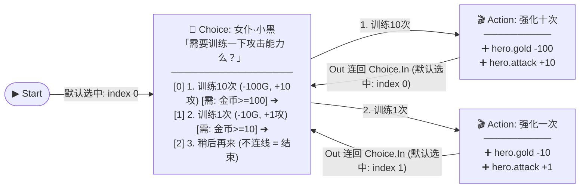
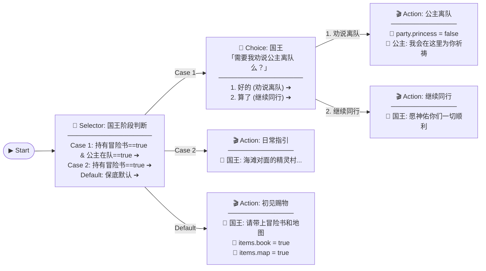

# 《紫水晶骑士物语》Action Tree（事件内部流图）架构与交互设计文档

## 1. 设计背景与核心目标

在完成顶层「任务与条件依赖大图（World Graph）」的基础上，为了更自然地表达复杂 NPC 交互、多阶段分支、玩家选项汇合（合流）以及连续属性强化循环，我们将原本 Event 内部的扁平 `ActionSequence` 升级为可视化的 **Action Tree（事件内部有向流图）**。

### 核心设计原则
1. **顶层条件唯一真相源（Single Source of Truth）**：
   - 所有状态与条件判断统一声明为顶层大图的 `🔍 Condition` 节点，描述 Event 依赖了哪些前置条件。
   - 外部只需连入 **1 个** `Condition`（如 `🔍 condition: 金币`），Event 内部即可针对该 Condition 灵活配置不同判断阈值（如 `>= 100`、`>= 10`），彻底消除隐藏条件，让顶层大图 100% 反映全局数据依赖与任务前提。
2. **复合动作不拆碎，分支/选项才分流**：
   - 连续的对话与变量修改收纳在单个 **`🎬 Action`（复合动作节点）** 中顺序执行；只有遇到条件分支（`Selector`）、玩家选项（`Choice`）或路径合流时才拆分为独立节点。
3. **连线即控制流（天然支持顺序、合流与循环回跳）**：
   - 无需专门的跳转节点，**`Out ➔ In` 连线本身就代表跳转**：
     - 向前连：顺序执行；
     - 多条线连入同一节点的 `In`：路径合流；
     - 从后续节点的 `Out` 连回前面节点的 `In`：循环回跳（如女仆小黑加完攻击直接连回选项节点，玩家不停点确认即可快速连续加攻）。
4. **全流程无弹窗 + Undo/Redo**：
   - 无论是顶层大图还是内部子图，均支持顶部按钮左键按住拖拽创建节点、点击端口连线、无确认弹窗直接删除，并全程支持 `Ctrl+Z` / `Ctrl+Y` 撤销与重做。

---

## 2. 双层图谱架构 (Two-Tier Graph Architecture)

| 层级 | 视图名称 | 节点构成 | 连线含义 | 核心职责 |
| :--- | :--- | :--- | :--- | :--- |
| **L1 顶层** | **全局任务依赖图**<br>*(Main Graph)* | `🔍 Condition` (前置条件节点)<br>`💬 Event` (任务/事件节点) | `Condition ➔ Event`<br>声明该事件依赖哪些外部条件 | 鸟瞰全图任务拓扑、围绕任意道具/状态查看上下游因果关系 |
| **L2 内层** | **事件 Action Tree 子图**<br>*(Event Sub-Graph)* | `▶ Start` (入口)<br>`🔀 Selector` (多路选择)<br>`💬 Choice` (玩家选项)<br>`🎬 Action` (复合动作) | `Out 端口 ➔ In 端口`<br>表达事件内部的顺序、分支、合流与回跳循环 | 编写事件内部的具体判断逻辑、对话台词、状态修改与循环交互 |

---

## 3. Action Tree 核心节点类型定义（4 类节点）

每个 `Event` 内部子图仅由以下 **4 类极简节点** 构成，除 `Start` 外，所有节点左侧均具备 **1 个输入端口 `In`（支持多条上游或下游回跳连线汇入）**：

### 3.1 `▶ Start`（入口节点）
- **端口**：无输入端口；右侧 **1 个输出端口 `Out`**。
- **职责**：每个 Event 子图固定唯一的起点，指向事件触发后第一个执行的节点。
- **限制**：不可删除，可自由拖拽位置。

### 3.2 `🔀 Selector`（多路条件分支节点）
- **端口**：
  - 左侧：`1 个 In`（支持多线汇入或循环回跳汇入）
  - 右侧：**N 个条件分支输出端口（`Case 1`, `Case 2`, ...）** + 底部固定 **1 个 `Default (保底)` 输出端口**。
- **判断逻辑**：
  - 每个分支（Case）可添加 1 条或多条针对**当前 Event 所依赖的 Condition** 的判断规则（`ConditionCheck`）：
    - 若 Condition 绑定布尔变量（如 `items.book`），可直接判 `== true`（满足）或 `== false`（不满足）。
    - 若 Condition 绑定数值/枚举变量（如 `hero.gold`），可配置比较符与阈值（如 `>= 100`、`>= 10`）。
  - 运行时**从上到下依次求值**，命中**第一个满足条件**的分支，即沿其右侧 `Out` 端口流向下一节点；若所有条件分支均不满足，则走底部的 `Default` 端口。

### 3.3 `💬 Choice`（玩家选项分流节点）
- **端口**：
  - 左侧：`1 个 In`（支持多线汇入或循环回跳汇入）
  - 右侧：**每个选项（Option）对应 1 个独立的输出端口 `Out`**。
- **连入默认选项索引（`defaultOptionIndex`）**：
  - **所有连入 `Choice` 节点的连线都必须设置默认选中的选项 `index`（默认值为 `0`，即最上面那个选项）**。
  - 不同上游节点连入同一个 `Choice` 时，可根据各自上下文指定不同的默认焦点选项（例如：从 `Start` 初次进入默认选中第 `0` 项；而从“训练 1 次”动作节点循环回跳连入时，可将默认选中 `index` 设为 `1`，使焦点保持在“训练 1 次”选项上）。
- **节点内容**：
  - 提问台词配置：说话人（`speaker`）、头衔（`speakerTitle`）、头像（`avatar`）、台词正文（`text`）。
  - 选项列表（`options`）：每项包含按钮文案（`text`）、按钮样式（`primary / secondary / danger`）以及可选的**前置 Condition 条件（`checks`）**。
- **运行逻辑**：
  - 弹出 RPG 选项对话框，并根据当前进入该节点的连线所配置的 `defaultOptionIndex`（默认 `0`，即最上面一项）高亮/聚焦默认选项；若某选项配置了前置 Condition 条件（如 `金币 >= 100`）且当前不满足，该选项按钮在弹窗中自动**置灰禁用**。
  - 玩家点击（或按确认键选择）某个可用选项后，沿该选项对应的 `Out` 端口流向下一个节点（若某选项 `Out` 未连线，则点击后直接结束对话）。
  - 不同选项的后续节点可以连入同一个下游节点的 `In`（合流），也可以连回当前 `Choice` 节点的 `In`（循环加点，并保持对应选项的默认选中 `index`）。

### 3.4 `🎬 Action`（复合动作序列节点）
- **端口**：
  - 左侧：`1 个 In`（支持多条路径合流汇入）
  - 右侧：`1 个 Out`（执行完序列后流向下一节点；若不连线则代表事件结束；若连回前面的节点则形成循环）
- **节点内容**：
  - 内部维护一个顺序执行的原子动作列表 `steps: AtomicStep[]`，支持三种原子操作：
    1. `💬 对话 (say)`：说话人、头衔、头像、台词文本（支持 `{hero.gold}` 变量插值与 BBCode 颜色）、确认按钮文案。
    2. `📝 赋值 (set)`：设置目标变量为指定常量，或复制另一变量的值（如 `hero.hp = from:hero.maxHp`）。
    3. `➕ 增减 (add)`：对数值型变量进行加减（如 `hero.gold += -100`、`hero.attack += 10`）。
- **设计优势**：没有分支时，连续的多句对话和多次属性修改紧凑排列在同一个 `Action` 节点内，保持画布清爽。

---

## 4. 典型业务场景图解

### 场景 A：`⚔️ 女仆·小黑 (攻击训练)` —— 单金币 Condition 多阈值 + 连线直接回跳循环

- **顶层大图**：`🔍 condition: 金币 (hero.gold)` ──连入──➔ `⚔️ 女仆·小黑 (攻击)`
- **内部 Action Tree 子图**：



> **玩家体验**：点击“训练 1 次”（`index = 1`）扣除 10G 并 +1 攻击后，顺着 `Act1` 的 `Out` 连线直接跳回 `ChoiceTrain` 的 `In`（该连线设置默认选中 `index = 1`），瞬间重新刷新小黑的训练窗口且焦点保持在“训练 1 次”上（此时面板上的 `{hero.attack}` 与 `{hero.gold}` 数值已实时更新！），玩家不停点确认即可丝滑连续加攻，直到金币不足按钮置灰或点击“稍后再来”（该选项不连线，直接结束对话）。

---

### 场景 B：`👑 国王 (king_conversation)` —— 多路 Selector + 选项分流与合流

- **顶层大图**：`🔍 condition: 持有冒险书` 与 `🔍 condition: 公主在队伍` ──连入──➔ `👑 国王`
- **内部 Action Tree 子图**：



---

## 5. 数据结构规范 (TypeScript Interfaces)

```typescript
/** 内部节点对所依赖 Condition 的具体判断规则 */
export interface ConditionCheck {
  conditionId: string; // 必须属于当前 Event 所依赖的 incomingConditions
  op?: CompareOp;      // 比较符（如 '==', '>='），默认使用 Condition 主条件的比较符
  value?: VarValue;    // 比较阈值（如 true, false, 100, 10）
}

/** 复合 Action 节点内的原子步骤（不含嵌套分支） */
export type AtomicStep = SayStep | SetStep | AddStep;

/** 1. 入口节点 */
export interface StartGraphNode {
  id: string;
  type: 'start';
  x: number;
  y: number;
  nextId?: string;          // Out 端口指向的节点 ID
  defaultOptionIndex?: number; // 若目标为 Choice 节点，指定默认选中的选项 index（默认 0，即最上面那个）
}

/** 2. 多路条件分支节点 (Selector) */
export interface SelectorCase {
  id: string;
  title: string;
  checks: ConditionCheck[]; // 全部满足时命中此分支
  targetId?: string;        // 该分支 Out 端口指向的节点 ID
  defaultOptionIndex?: number; // 若目标为 Choice 节点，指定默认选中的选项 index（默认 0，即最上面那个）
}

export interface SelectorGraphNode {
  id: string;
  type: 'selector';
  title: string;
  x: number;
  y: number;
  cases: SelectorCase[];
  defaultTargetId?: string;    // Default 保底出口指向的节点 ID
  defaultOptionIndex?: number; // 若 Default 保底目标为 Choice 节点，指定默认选中的选项 index（默认 0，即最上面那个）
}

/** 3. 玩家选项分流节点 (Choice) */
export interface ChoiceGraphOption {
  id: string;
  text: string;
  style?: ButtonStyle;
  checks?: ConditionCheck[]; // 选项可用前置条件（基于所依赖的 Condition，如 金币 >= 100）
  targetId?: string;        // 该选项 Out 端口指向的节点 ID
  defaultOptionIndex?: number; // 若目标为 Choice 节点，指定默认选中的选项 index（默认 0，即最上面那个）
}

export interface ChoiceGraphNode {
  id: string;
  type: 'choice';
  title: string;
  x: number;
  y: number;
  speaker: string;
  speakerTitle?: string;
  avatar?: string;
  text: string;
  options: ChoiceGraphOption[];
}

/** 4. 复合动作序列节点 (Action) */
export interface ActionGraphNode {
  id: string;
  type: 'action';
  title: string;
  x: number;
  y: number;
  steps: AtomicStep[];      // 顺序执行的 Say / Set / Add 列表
  nextId?: string;          // Out 端口指向的节点 ID（可连向任意后续或前置节点）
  defaultOptionIndex?: number; // 若目标为 Choice 节点，指定默认选中的选项 index（默认 0，即最上面那个）
}

export type ActionGraphNodeUnion =
  | StartGraphNode
  | SelectorGraphNode
  | ChoiceGraphNode
  | ActionGraphNode;

/** Event 内部子图结构 */
export interface ActionGraph {
  nodes: ActionGraphNodeUnion[];
}
```

---

## 6. 交互与 UI 工作流设计

1. **进入与退出内部子图**：
   - **进入**：在「编辑模式」下双击任意 `Event` 节点，或点击右侧详情面板顶部的 **「🕸️ 进入 Action Tree 内部图谱」** 按钮。
   - **子图顶栏浮标**：画布顶部显示醒目的导航条：
     `[← 返回全局大图 (ESC)]` | `当前事件：⚔️ 女仆·小黑 (攻击)` | `[▶ 立即试玩此事件]`
   - **顶部拖拽创建切换**：处于子图视图时，顶部工具栏提供 **`+ 🎬 Action`**、**`+ 🔀 Selector`**、**`+ 💬 Choice`** 三个按钮，同样支持**按住鼠标左键直接拖入画布任意位置松开创建**！
2. **端口连线、回跳弧线与断开**：
   - 每个 `Selector` 的每个分支行右侧、每个 `Choice` 的每个选项行右侧、以及 `Start` 和 `Action` 的右侧均有发光输出端点 `Out`。
   - 点击任意 `Out` 端点再点击目标节点的左侧 `In` 端点即可建立连接：
     - 支持多个 `Out` 连入同一个节点的 `In`（**合流**）；
     - 支持右侧节点的 `Out` 连回左侧节点的 `In`（**循环回跳**，画布自动绘制平滑绕行弧线，不遮挡卡片文字）；
     - 当连线目标是 `Choice`（玩家选项）节点时，自动设置该连线的默认选择 `defaultOptionIndex = 0`（默认最上面那个选项），并可在右侧面板中修改为任意选项 `index`。
   - 直接点击已有连线即可一键断开（无弹窗，支持 `Ctrl+Z` 撤销）。
3. **右侧详情面板联动**：
   - 在子图画布中单击任意节点（`Action` / `Selector` / `Choice`），右侧面板立即切换为该内部节点的专属编辑器（编辑 `Action` 内的对话/赋值步骤列表、配置 `Selector` 分支的 Condition 规则、配置 `Choice` 选项等）。
   - 点击子图空白处，右侧面板展示当前所属 `Event` 的基础属性与所依赖的 `Condition` 列表。

---

## 7. 实施步骤规划

1. **Step 1 - 数据模型与 `castle.json` 全量升级 (`src/core/types.ts` & `src/core/project.ts` & `data/castle.json`)**：
   - 新增 `ActionGraph` 及 4 类子图节点（`Start`、`Selector`、`Choice`、`Action`）定义。
   - 在 `data/castle.json` 中配置 `🔍 condition: 金币 (hero.gold)` 并关联三个女仆 Event；将所有城堡事件迁移为 `ActionGraph` 子图（其中三个女仆训练事件的强化动作节点 `Out` 直接连回 `Choice` 节点的 `In` 形成加点循环）。
2. **Step 2 - 执行器与图分析引擎升级 (`src/core/engine.ts` & `src/core/graph.ts`)**：
   - 实现 `runActionGraph` 图执行器（支持 `Start ➔ Selector / Choice / Action` 任意图流转、回跳循环与单帧防死循环保护）。
   - 升级 `graph.ts` 的变量读写分析器，确保左栏道具/状态焦点视图与顶层大图连线实时联动。
3. **Step 3 - 子图画布渲染与拖拽创建 (`src/panels/GraphCanvas.ts` & `src/panels/Header.ts`)**：
   - 在 `GraphCanvas` 中实现 Event 子图下钻模式：支持 4 类节点卡片渲染、多端口正向/反向回跳贝塞尔曲线连线、点击断线、节点拖拽布局。
   - 在 `Header` 中实现子图专属拖拽按钮（`+ 🎬 Action`、`+ 🔀 Selector`、`+ 💬 Choice`），按住左键拖到画布即可创建。
4. **Step 4 - 右侧详情面板适配 (`src/panels/NodeInspector.ts`)**：
   - 支持选中顶层 Event 时预览子图摘要并一键进入子图；
   - 支持选中子图内任意节点时编辑其详细属性（`Selector` 分支 Condition 阈值、`Choice` 选项与条件、`Action` 内部步骤列表）。
