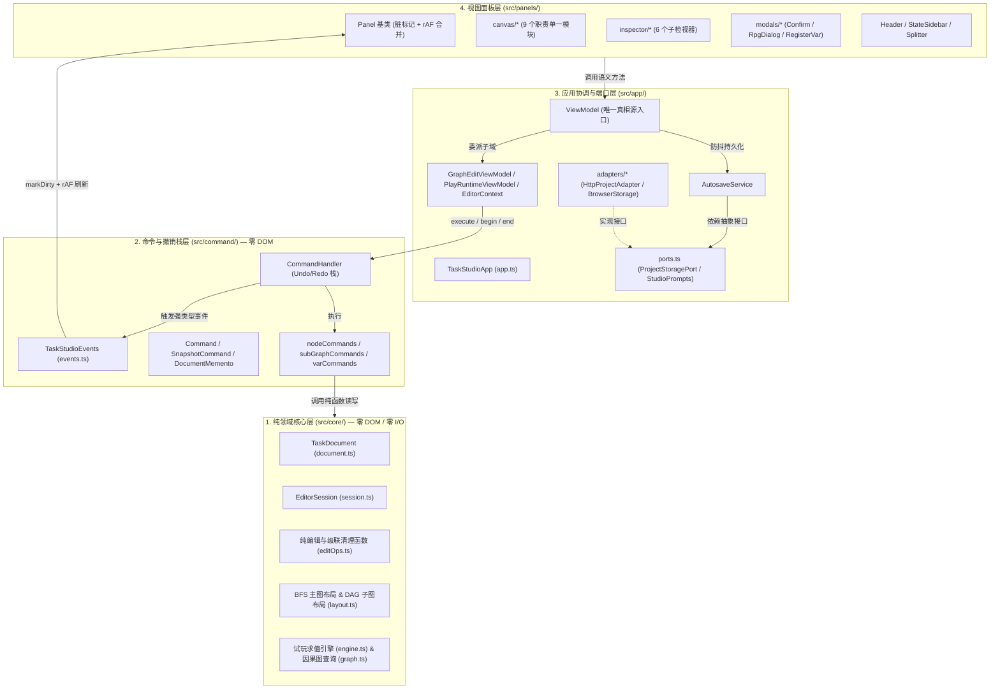
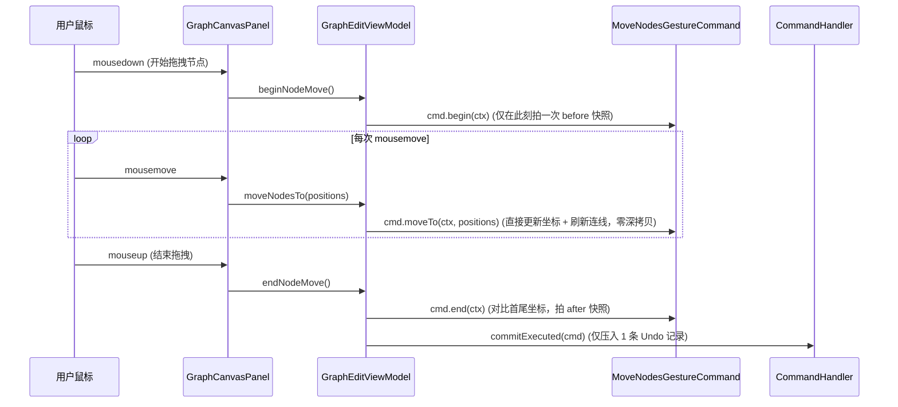

# 《紫水晶骑士物语》任务系统重构学习文档 & Code Review 指南

本文档旨在帮助你系统地 Review 重构后的 `game_task_system` 代码库，并深入理解从 `64px-portrait-studio` 借鉴并落地的**四层单向依赖架构**、**命令模式（Command + Memento）**、**端口-适配器（Ports & Adapters）**以及**脏标记合并渲染（Dirty + `requestAnimationFrame`）**。

---

## 1. 宏观架构对比：重构前 vs 重构后

### 1.1 重构前的问题（巨石耦合态）
- **单文件膨胀**：原 `GraphCanvas.ts` 高达 **4,114 行**，混杂了主图/子图/聚焦图 DOM 构建、SVG 连线、端口磁吸拖拽、多米诺动效与 BFS/DAG 数学排布算法；原 `NodeInspector.ts` 达 **1,925 行**；`style.css` 达 **2,622 行**。
- **隐式全局单例耦合**：所有面板直接 import `project` 和 `appState` 两个全局可变单例，任何地方直接调用 `project.change(d => ...)` 原地修改 JSON 对象。
- **核心层夹带副作用**：原 `project.ts` 同时负责数据存储、旧版数据迁移、Undo 历史和 `fetch('/api/save-castle')` 网络请求，无法脱离浏览器做无头（Headless）单元测试。

### 1.2 重构后的四层单向依赖架构

> [!IMPORTANT]
> **铁律（由单元测试自动守护）**：
> `src/core/`、`src/command/`、[viewModel.ts](../src/app/viewModel.ts)、[ports.ts](../src/app/ports.ts) 与 [AutosaveService.ts](../src/app/services/AutosaveService.ts) **绝对禁止**访问 `window`、`document`、`localStorage`、`fetch` 或 `HTMLElement`。这一边界由 [adapterBoundary.test.ts](../tests/adapterBoundary.test.ts) 通过 TypeScript AST 静态语法树扫描强制把关。

---

## 2. 核心设计模式详解（学习重点）

### 2.1 状态三分法：`TaskDocument` vs `EditorSession` vs `EditorContext`
参考 `64px-portrait-studio` 将状态按生命周期与职责切分为三块：

1. **[`TaskDocument`](../src/core/document.ts)（持久化工程文档）**
   - 包含：`version`、`name`、`vars`、`conditions`、`events`、`presets`。
   - 特点：与 `data/castle.json` 1:1 对应；任何修改必须经过 [`Command`](../src/command/command.ts)，自动进入 Undo/Redo 栈并触发 [`AutosaveService`](../src/app/services/AutosaveService.ts)。
2. **[`EditorSession`](../src/core/session.ts)（编辑会话与试玩运行时黑板）**
   - 包含：`mode`（`play` / `edit`）、`viewMode`（`main` / `focal` / `subgraph`）、`selection`（单选/多选）、`focalVarKey`、`subGraphEventId`、`worldState`（试玩黑板变量值）。
   - 特点：不写入 `castle.json`。其中 `selection` 随文档快照一起被 [`DocumentMemento`](../src/command/command.ts) 记录，因此撤销删除节点时会自动恢复被删节点的选中高亮！
3. **[`EditorContext`](../src/app/editorContext.ts)（纯 UI 瞬态上下文）**
   - 包含：`logs`（实时事件流转日志列表）、`registerVarModalOpen`（注册变量弹窗开关）、`canvasDragReceiving`（顶栏拖拽进入画布高亮态）。

---

### 2.2 命令模式与手势事务（`SnapshotCommand` + Gesture Transaction）

在 [command.ts](../src/command/command.ts) 中，我们实现了通用的 `SnapshotCommand`：
- **普通离散操作**（如新建/删除节点、连线、修改属性）：
  调用 `this.init(ctx)` 捕获修改前的 `DocumentMemento`，执行纯函数修改 `ctx.doc`，再调用 `this.finish(ctx)` 捕获修改后的快照并触发事件。
- **高频连续输入合并（`coalesceKey`）**：
  在检视器输入框打字时，[`MutateDocumentCommand`](../src/command/nodeCommands.ts) 携带 `coalesceKey`（例如 `ev_title_evt_king`）。[`CommandHandler.execute`](../src/command/commandHandler.ts) 检测到栈顶命令具有相同 `coalesceKey` 且在 `1500ms` 窗口内时，直接调用 `top.mergeWith(cmd)` 合并快照，避免每敲一个字母产生一条 Undo。
- **画布拖拽手势闭环（[`MoveNodesGestureCommand`](../src/command/nodeCommands.ts)）**：

---

### 2.3 脏标记 + `requestAnimationFrame` 批量渲染（[`Panel`](../src/panels/Panel.ts)）

以前一次操作如果同时触发 `onDocumentChanged`、`onSelectionChanged` 和 `onSessionChanged`，会导致画布和检视器在同一帧内重复销毁重建 DOM 2～3 次。

现在所有 UI 面板继承自 [Panel.ts](../src/panels/Panel.ts)：
- 面板在构造函数中自动注册为 `ViewModel` 的事件监听器（`vm.registerListener(this)`）。
- 当收到事件时，面板只调用 `this.markDirty()`，将自身加入全局 `dirtyPanels` 集合，并请求一次 `requestAnimationFrame(flush)`。
- 在下一帧渲染前，`flush()` 一次性遍历所有脏面板调用一次 `panel.render()`。
- 销毁时调用 `panel.dispose()`，自动取消监听并移出脏队列。

---

## 3. 四个隐藏 Bug 的架构级修复对照

| 编号 | 原 Bug 现象与根因 | 重构后的架构级修复位置 |
| :--- | :--- | :--- |
| **Bug #1** | 每次修改 HP/金币、切换预设或切换 Edit/Play 模式时，`StateSidebar.render()` 执行 `this.container.innerHTML = ...` 把 `#logBox` 连根覆盖，导致历史日志全部丢失。 | 1. 日志列表提升至 [`EditorContext.logs`](../src/app/editorContext.ts) 持久化保存； 2. [`StateSidebar`](../src/panels/StateSidebar.ts) 将 `#sidebarControlsRoot` 与 `#logBox` 分离，`render()` 只刷新控制区，日志通过 `onLogAdded` 增量追加。 |
| **Bug #2** | 多选批量删除或按 `Delete` 键删除 Condition / 子图节点时，未清理 `selector.cases.checks`、`choice.options.checks` 及其他子节点的 `nextId`/`targetId`，留下幽灵悬空引用。 | 在 [editOps.ts](../src/core/editOps.ts) 中统一封装 `deleteConditionCascade`、`deleteSubNodeCascade` 与 `deleteNodesBatch`，所有删除入口统一走 [`DeleteBatchCommand`](../src/command/nodeCommands.ts)。 |
| **Bug #3** | 拖拽节点时每次 `mousemove` 都执行 `structuredClone` 深拷贝，且拖拽超过 1.5 秒会被拆成多条碎片 Undo 记录。 | 引入 [`MoveNodesGestureCommand`](../src/command/nodeCommands.ts)（`beginNodeMove` -> `moveNodesTo` -> `endNodeMove`），拖拽过程零深拷贝，松手只生成 1 条 Undo。 |
| **Bug #4** | 多处使用浏览器原生阻塞式 `prompt()`、`confirm()`、`alert()`，样式突兀且无法自动化测试。 | 1. 抽象 [`StudioPrompts`](../src/app/ports.ts) 端口并实现非阻塞弹窗 [`ConfirmModal`](../src/panels/modals/ConfirmModal.ts)； 2. [`EventInspector`](../src/panels/inspector/EventInspector.ts) 改为内联 `<select>` 选择器关联已有 Condition。 |

---

## 4. 推荐的 Code Review 顺序（由内向外）

建议按照以下 5 步顺序阅读代码，最容易建立完整的全局心智模型：

### 第一站：看测试（5 分钟快速把握系统契约）
1. [adapterBoundary.test.ts](../tests/adapterBoundary.test.ts)：看 AST 静态扫描如何保证 `core/` + `command/` + `ViewModel` 零浏览器依赖，以及如何在禁用 `window`/`document` 的环境下直接用 `new ViewModel()` 跑通增删改与 Undo。
2. [coreAndCommand.test.ts](../tests/coreAndCommand.test.ts)：看级联删除、拖拽手势单步 Undo、子图有环 DAG 布局、日志留存、变量删除确认弹窗的测试案例。

### 第二站：看纯领域层 `src/core/`（数据结构与纯算法）
1. [types.ts](../src/core/types.ts)、[document.ts](../src/core/document.ts)、[session.ts](../src/core/session.ts)：了解核心类型、文档与会话的边界。
2. [editOps.ts](../src/core/editOps.ts)：重点看各类级联清理逻辑（如删除 Condition 时如何同时清理主图 `incomingConditions` 和子图 `Selector`/`Choice` 里的判断规则）。
3. [layout.ts](../src/core/layout.ts)：看主图的双列分组排布与子图的分层拓扑排序（Kahn + DFS 回边环路兼容）算法。

### 第三站：看命令层 `src/command/`（Undo/Redo 是如何工作的）
1. [events.ts](../src/command/events.ts)：8 个强类型事件回调接口 `TaskStudioEvents`。
2. [command.ts](../src/command/command.ts) & [commandHandler.ts](../src/command/commandHandler.ts)：看 `SnapshotCommand` 如何捕获前后快照、如何通过 `emitMementoDiff` 智能派发最小事件。
3. [nodeCommands.ts](../src/command/nodeCommands.ts)、[subGraphCommands.ts](../src/command/subGraphCommands.ts)、[varCommands.ts](../src/command/varCommands.ts)：每个命令都只有十几行，清晰调用 `editOps.ts` 中的纯函数。

### 第四站：看应用协调层 `src/app/`（状态中枢与适配器）
1. [ports.ts](../src/app/ports.ts) & [AutosaveService.ts](../src/app/services/AutosaveService.ts)：看自动保存防抖如何与 `fetch` 解耦。
2. [viewModel.ts](../src/app/viewModel.ts)、[graphEditViewModel.ts](../src/app/graphEditViewModel.ts)、[playRuntimeViewModel.ts](../src/app/playRuntimeViewModel.ts)：看 `ViewModel` 如何把“图谱编辑”与“试玩运行时”拆给两个专注的子 ViewModel。
3. [app.ts](../src/app/app.ts)：看 `TaskStudioApp` 如何在 100 行内把适配器、弹窗、ViewModel、各大面板和快捷键干净地组装起来。

### 第五站：看视图面板层 `src/panels/`（按模块拆分的 UI）
1. [Panel.ts](../src/panels/Panel.ts)：60 行代码实现的脏标记 + `requestAnimationFrame` 基类。
2. 画布模块 `src/panels/canvas/`：
   - 总控面板：[GraphCanvasPanel.ts](../src/panels/canvas/GraphCanvasPanel.ts)
   - 三大视图渲染器：[MainGraphRenderer.ts](../src/panels/canvas/MainGraphRenderer.ts)、[SubGraphRenderer.ts](../src/panels/canvas/SubGraphRenderer.ts)、[FocalGraphRenderer.ts](../src/panels/canvas/FocalGraphRenderer.ts)
   - 连线与交互控制器：[EdgeRenderer.ts](../src/panels/canvas/EdgeRenderer.ts)、[WireInteraction.ts](../src/panels/canvas/WireInteraction.ts)、[PortPlacement.ts](../src/panels/canvas/PortPlacement.ts)
   - 特效与菜单：[DominoCascadeOverlay.ts](../src/panels/canvas/DominoCascadeOverlay.ts)、[CanvasContextMenu.ts](../src/panels/canvas/CanvasContextMenu.ts)
3. 检视器模块 `src/panels/inspector/`：
   - 总控面板：[NodeInspectorPanel.ts](../src/panels/inspector/NodeInspectorPanel.ts)
   - 五类选中项子检视器：[EventInspector.ts](../src/panels/inspector/EventInspector.ts)、[SubNodeInspector.ts](../src/panels/inspector/SubNodeInspector.ts)、[ConditionInspector.ts](../src/panels/inspector/ConditionInspector.ts)、[VarInspector.ts](../src/panels/inspector/VarInspector.ts)、[MultiSelectInspector.ts](../src/panels/inspector/MultiSelectInspector.ts)
4. 顶栏与状态栏：[Header.ts](../src/panels/Header.ts)、[StateSidebar.ts](../src/panels/StateSidebar.ts)、[Splitter.ts](../src/panels/Splitter.ts)

